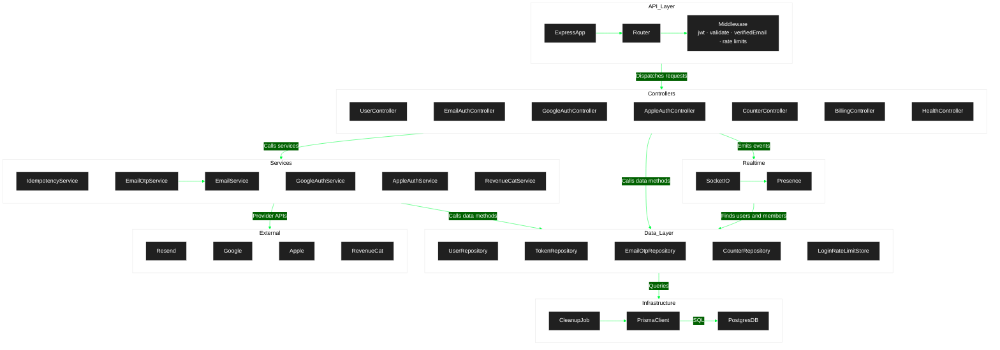

### Server Side Data Flow

Counter mutations run inside `IdempotencyService` transactions. A retry with the same key replays the stored response.

Google and Apple sign-in finish through `UserController.sendSession()`, the same session path as password login.

The `jwt` middleware loads the session user from `UserRepository`. Login rate limits use `LoginRateLimitStore`, so the limits hold across processes.

`CleanupJob` runs at startup and then once a day. It deletes expired refresh tokens and login limits.
