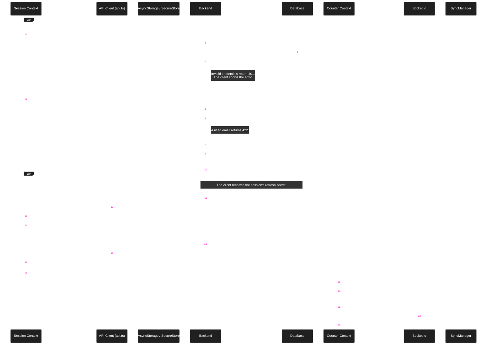

### Login and Registration Flow

Login and registration use one client path. Both responses start a new session. Google and Apple sign-in end with the same session response.

Login opens Home, or the pending invite. Registration opens Verify Email. "Skip for now" opens Home without verification.
Home sends an account without a username to the username step. Sharing, joining, and purchases still require a verified email.
