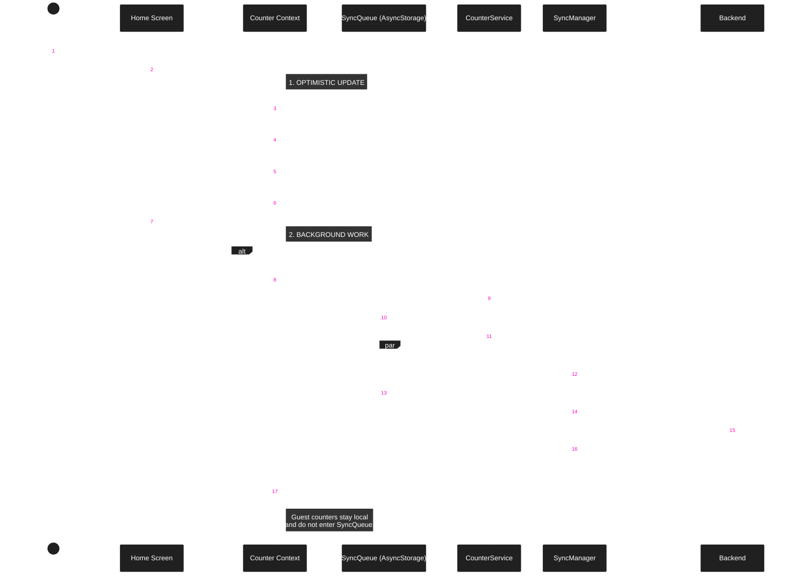

### Offline/Optimistic Counter Creation

New counters are personal. Starting sharing is a separate online action after pending writes finish.
The server creates the invite after checking ownership, email verification, and Premium access.
